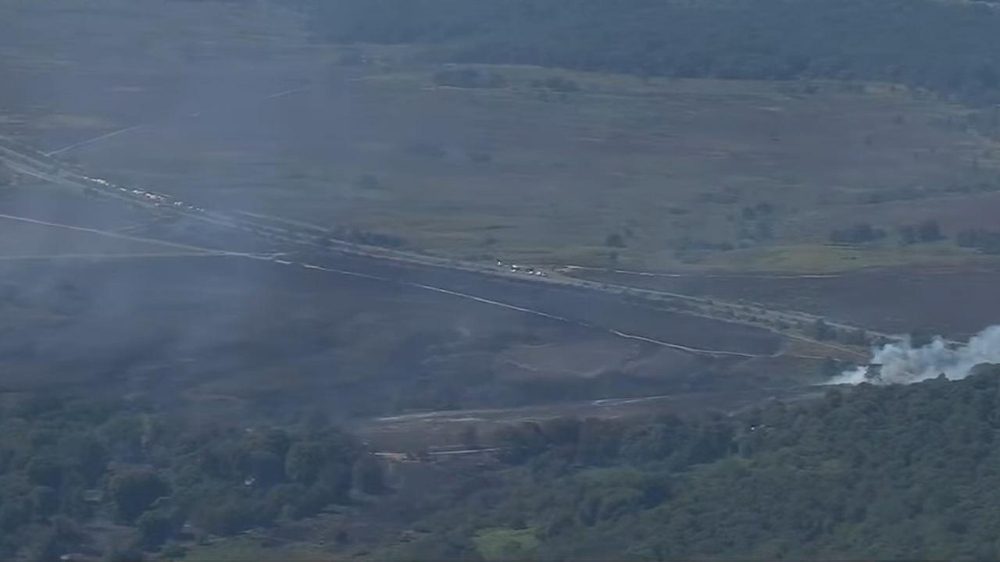
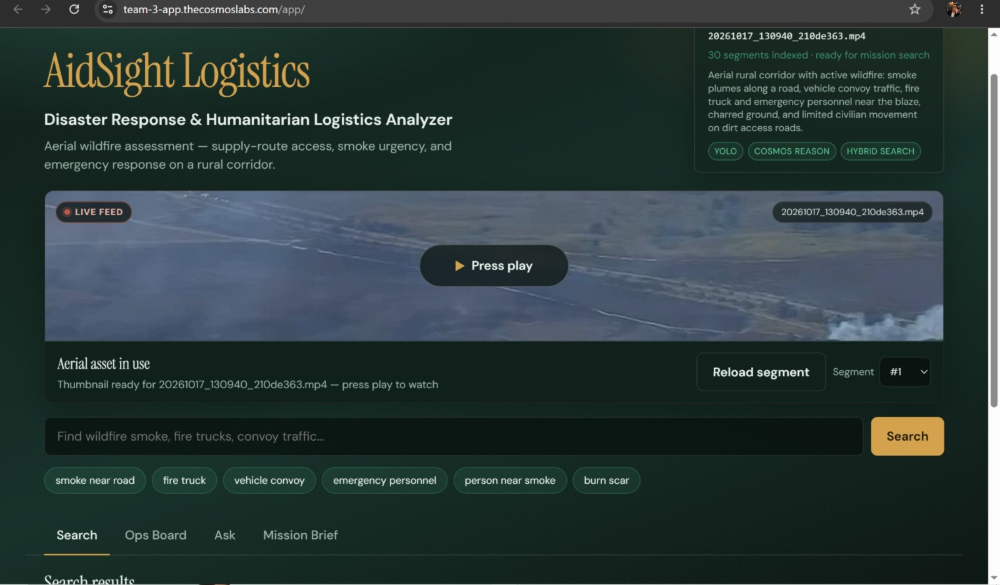
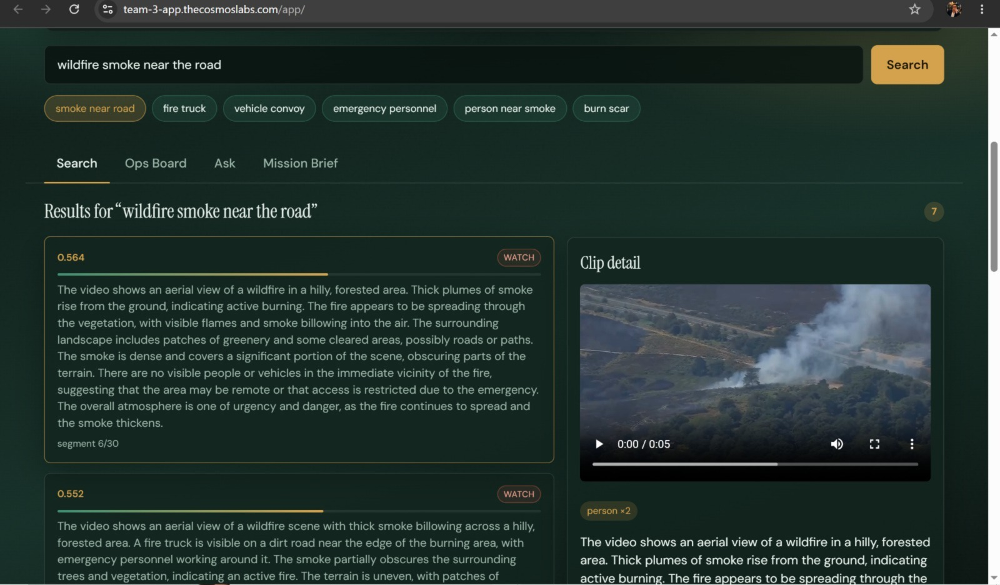
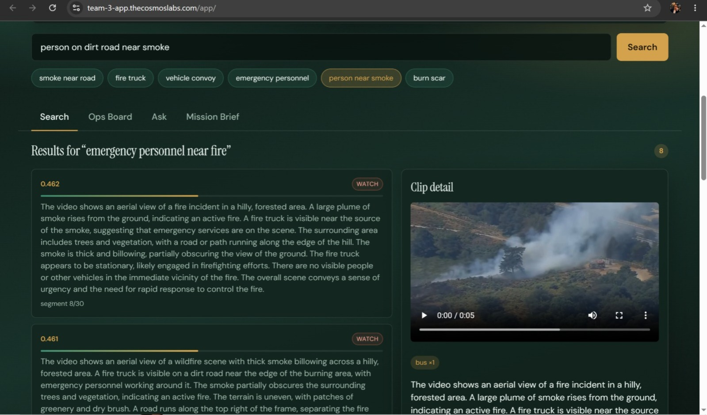

# AidSight Logistics

**Real-Time Disaster Response & Humanitarian Logistics Analyzer**

Live demo: [team-3-app.thecosmoslabs.com/app](https://team-3-app.thecosmoslabs.com/app/)

## The Problem

During an active crisis, rescue services and humanitarian organizations (like British-Ukrainian Aid) deploy fleets of drones to survey disaster zones. While this provides visual coverage, raw streaming video is overwhelming and inherently unstructured. Human operators lose critical time manually monitoring multiple live feeds to spot hazards, calculate map coordinates, and verify if a supply corridor is safe. In humanitarian logistics, information delay costs lives.



*Raw focal footage: aerial rural corridor with wildfire smoke, road traffic, and emergency response.*

## The Solution

AidSight Logistics is an autonomous intelligence pipeline that transforms live, geolocated drone streams into an actionable, real-time tactical map. By combining precise spatial object detection with deep temporal reasoning, AidSight automatically pinpoints active fires, tracks emergency convoys, and assesses route traversability without manual video scrubbing. It gives rescue commanders instant, geolocated clarity to direct aid exactly where it is needed most.



*Mission Ops Board — live feed, indexing status, and mission lanes in one pane.*

## Key Capabilities

- **Live Geolocated Ingestion:** Directly ingests streaming video from drone fleets paired with real-time geolocation telemetry, automatically translating visual hazards (like active fires) into precise map coordinates.
- **Contextual Hazard & Asset Tracking:** Utilizes YOLO11 to track physical entities like emergency personnel, fire trucks, and civilian convoys. NVIDIA Cosmos3-Reason simultaneously evaluates the scene's urgency, detecting nuanced threats like wildfire smoke drifting across an escape route or an obstructed dirt road.
- **The Mission Ops Board:** Instead of watching a video feed, commanders monitor a live triage board. The system automatically categorizes incoming intelligence into three distinct mission lanes: Supply Routes, Fire Response, and Access & People.
- **Conversational Archival Search:** Coordinators can query the massive video index using natural language. By asking, "Where is the fire truck relative to the smoke?", the hybrid search agent instantly retrieves the exact timestamped and geolocated evidence clip.
- **Automated Mission Briefs:** To keep ground teams and executives aligned, the platform uses a Weights & Biases LLM to instantly draft structured operational briefs based on the verified YOLO and Cosmos evidence.



*Natural-language search — e.g. “wildfire smoke near the road” — over the indexed aerial footage.*



*Hybrid search results with timestamped, geolocated evidence clips.*

## The Technical Architecture

Built for the VAST Builders Challenge, the application is scoped for production-grade resilience and rapid intelligence extraction.

- **Data & Orchestration Layer:** Powered by the VAST AI OS and VastDB. Cosmos Embed1 indexes segments of the focal aerial wildfire footage directly into VastDB, enabling sub-second hybrid semantic search.
- **AI Reasoning Stack:** YOLO handles rigid object detection, while NVIDIA Cosmos models parse the temporal and spatial reasoning of the disaster scene.
- **Application Layer:** A lightweight, single-pane-of-glass Flask application deployed via Kubernetes to `/app`, locking all VSS APIs, agent actions, and LLM synthesis directly to the verified ground-truth asset.

## The Impact

By integrating high-performance cloud compute with multimodal AI and drone telemetry, AidSight Logistics bridges the gap between raw mission video and real-time incident coordination. It removes the cognitive load from overloaded human operators, ensuring rescue services and aid organizations can secure supply lines and save lives with pinpoint accuracy.

---

## Focal footage

`20261017_130940_210de363.mp4` — aerial rural corridor with wildfire smoke, road traffic, fire truck response, and emergency personnel.

## Stack

- Flask app on Kubernetes Ingress `/app`
- VSS retrieval APIs (search, agent Q&A, videos, detections)
- Optional Weights & Biases serverless inference for mission briefs

## Local layout

```
main.py              # Flask API + VSS client
index.html           # Mission Ops UI
app.css / app.js     # Styles and client logic
static/              # Served assets
k8s/deploy.sh        # Hackathon ConfigMap deploy (no registry)
requirements.txt
```

## Deploy (Builders Challenge VM)

```bash
bash k8s/deploy.sh
```

Then open [workshop.thecosmoslabs.com](https://workshop.thecosmoslabs.com) → **App**, or your team app URL: [team-3-app.thecosmoslabs.com/app](https://team-3-app.thecosmoslabs.com/app/).

## Security

Do not commit `/config/*.config`, passwords, or API keys. The deploy script reads credentials from the lab environment only.
